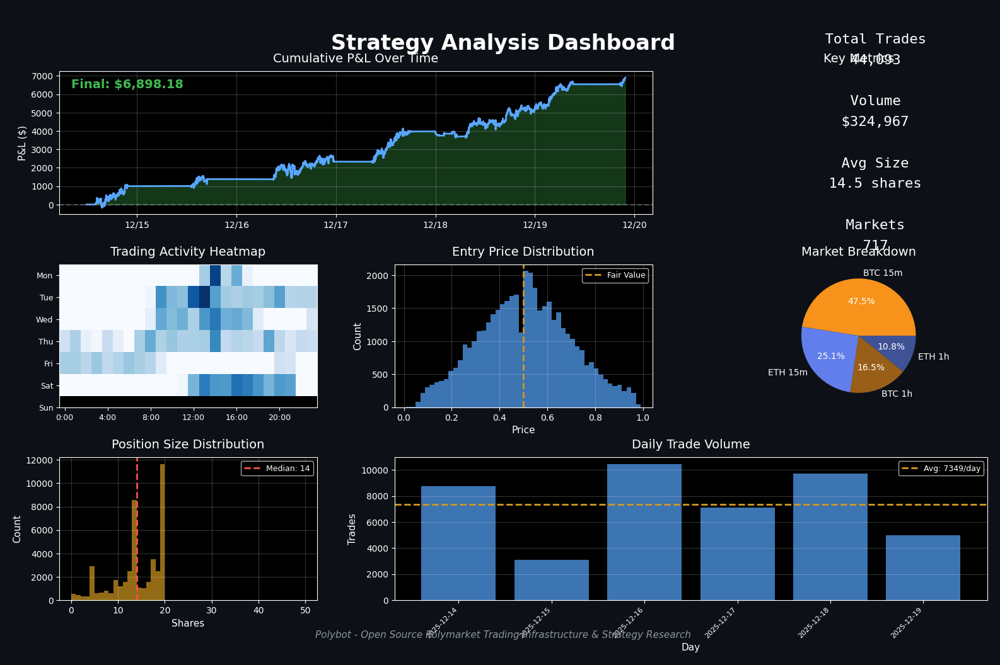

# Khaledpoly / Polybot

Phase-one reliability development: PAPER-only, durable account/order state, current API contracts and regression tests. Fills are disabled by default; this release makes no profitability claim. See [phase-one implementation and rollout limits](docs/PHASE1.md).

Open-source Polymarket trading infrastructure and strategy reverse-engineering toolkit.

Polybot is a multi-service system for:
- automated execution (paper and live modes)
- strategy runtime and market making
- market/user trade ingestion into ClickHouse
- quantitative analysis and replication scoring



## Future Work: AWARE Fund

Polybot is the execution and market-data foundation for **AWARE**, the next product layer (trader intelligence, PSI indices, fund mirroring, API/UI).

- Polybot repo: https://github.com/ent0n29/polybot
- AWARE repo: https://github.com/ent0n29/aware

## What You Get

- Java 21 microservices for execution, strategy, ingestion, analytics
- ClickHouse + Redpanda event pipeline
- Monitoring stack (Grafana, Prometheus, Alertmanager)
- Research toolkit in `research/` for snapshots, deep analysis, and replication metrics

## Quick Start (Recommended)

### Prerequisites

- Amazon Corretto 21 (recommended) or any Java 21+
- Maven 3.8+
- Docker Engine/Desktop with Compose plugin
- Python 3.11+ (for research scripts)

### 1. Clone

```bash
git clone https://github.com/khaledhasneen1993/Khaledpoly.git
cd Khaledpoly
```

### 2. Optional Environment Setup

```bash
cp .env.example .env
set -a; source .env; set +a
```

Note: Spring Boot does not auto-load `.env`; export variables in your shell when needed.

### 3. Start Everything

```bash
./start-all-services.sh
```

The launcher starts a lightweight PAPER executor and strategy with the `develop` profile. Set `POLYBOT_LIGHT=false` for analytics infrastructure; see docs/PHASE1.md.

### 4. Verify

```bash
curl http://localhost:8080/actuator/health
curl http://localhost:8081/actuator/health
curl http://localhost:8082/actuator/health
curl http://localhost:8083/actuator/health
curl http://localhost:8084/actuator/health
curl http://localhost:8123 --data "SELECT 1"
```

### 5. Stop

```bash
./stop-all-services.sh
```

## Operator Commands

### Build and Test

```bash
mvn clean package -DskipTests
mvn test
```

### Tail Logs

```bash
tail -f logs/executor-service.log
tail -f logs/strategy-service.log
tail -f logs/analytics-service.log
tail -f logs/ingestor-service.log
tail -f logs/infrastructure-orchestrator-service.log
```

### Manual Startup (Alternative)

```bash
mvn clean package -DskipTests

java -jar infrastructure-orchestrator-service/target/infrastructure-orchestrator-service-0.0.1-SNAPSHOT.jar --spring.profiles.active=develop
java -jar executor-service/target/executor-service-0.0.1-SNAPSHOT.jar --spring.profiles.active=develop
java -jar strategy-service/target/strategy-service-0.0.1-SNAPSHOT.jar --spring.profiles.active=develop
java -jar ingestor-service/target/ingestor-service-0.0.1-SNAPSHOT.jar --spring.profiles.active=develop
java -jar analytics-service/target/analytics-service-0.0.1-SNAPSHOT.jar --spring.profiles.active=develop
```

## Services and Ports

| Service | Port | Purpose | Example Endpoint |
|---|---:|---|---|
| executor-service | 8080 | order execution, paper sim, settlement endpoints | `/api/polymarket/health` |
| strategy-service | 8081 | strategy runtime and status | `/api/strategy/status` |
| analytics-service | 8082 | analytics APIs on ClickHouse data | `/api/analytics/status` |
| ingestor-service | 8083 | market/user-trade ingestion pipelines | `/actuator/health` |
| infrastructure-orchestrator-service | 8084 | lifecycle of analytics + monitoring stacks | `/api/infrastructure/status` |
| ClickHouse HTTP | 8123 | analytics SQL access | `SELECT 1` |
| Redpanda Kafka | 9092 | event streaming | Kafka bootstrap |
| Grafana | 3000 | dashboards | UI |
| Prometheus | 9090 | metrics scraping | UI |
| Alertmanager | 9093 | alert routing | UI |

## Configuration Essentials

Key variables are documented in `.env.example`.

Most relevant:
- `POLYMARKET_TARGET_USER` for strategy research workflows
- Legacy live credentials are not needed for this PAPER release; LIVE startup is locked pending rollout verification
- `KAFKA_BOOTSTRAP_SERVERS`, `ANALYTICS_DB_URL`, `CLICKHOUSE_*` for data pipeline
- `GRAFANA_ADMIN_PASSWORD`, `SLACK_WEBHOOK_URL` for ops/alerts

Default mode in develop profile is paper trading (`hft.mode: PAPER`).

## Included Strategy

Polybot includes a complete-set arbitrage strategy for Polymarket Up/Down binaries.

See `docs/EXAMPLE_STRATEGY_SPEC.md` for implementation details.

## Research Workflow

The `research/` directory contains scripts for:
- snapshot extraction and reporting
- replication and similarity scoring
- backtesting and calibration
- execution quality analysis

Start with `research/README.md`.

## Repo Layout

```text
polybot/
├── polybot-core/
├── executor-service/
├── strategy-service/
├── ingestor-service/
├── analytics-service/
├── infrastructure-orchestrator-service/
├── research/
├── monitoring/
├── start-all-services.sh
└── stop-all-services.sh
```

## Contributing

See `CONTRIBUTING.md` for setup, style, testing, and PR process.

## Disclaimer

This software is for educational and research purposes only.

Trading prediction markets carries financial risk. Always validate with paper mode before any live capital.

## License

MIT. See `LICENSE`.

## Phase 2 research

Phase 2 now includes shared closed-loop PAPER/replay, inventory exits, terminal-resolution ingestion and a frozen heldout evaluator. See [operation and evidence gates](docs/PHASE2_COMPLETION.md). Empirical acceptance is still NO_GO; phase 3 now includes an opt-in research API, Python SDK, public CEX signals, model/portfolio research and replayable shadow proposals ([delivery matrix and boundaries](docs/PHASE3_COMPLETION.md)). This does not promote a strategy or satisfy the empirical gate. Conservative maker fills replace the old random heuristic. LIVE remains locked; synthetic replay results do not demonstrate profitability.
